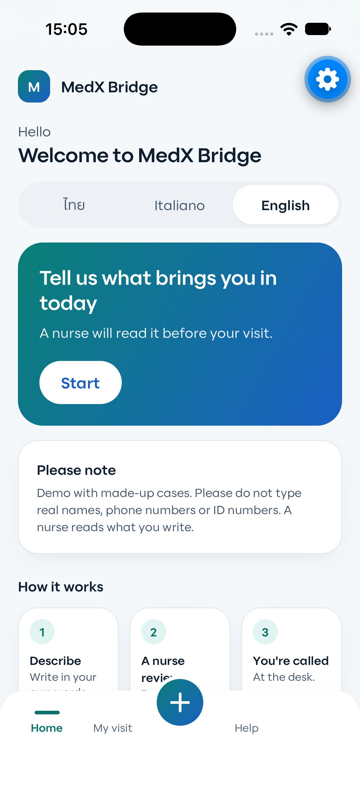
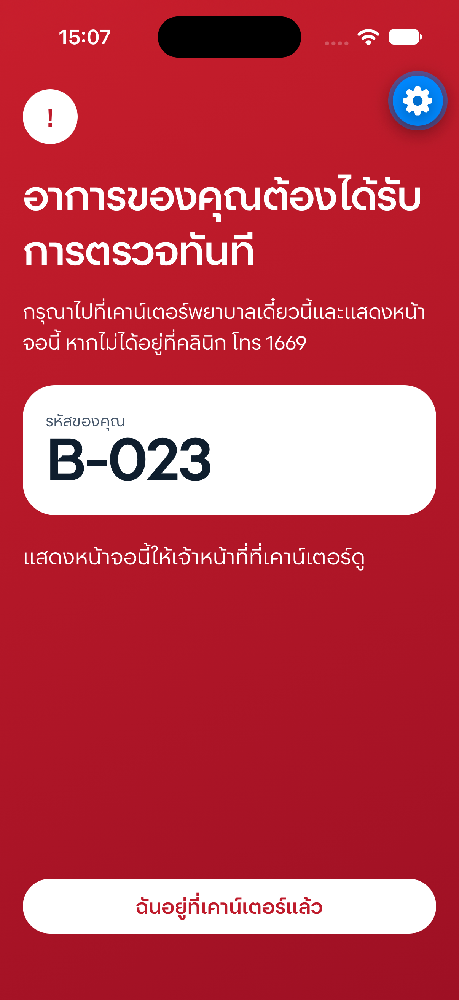
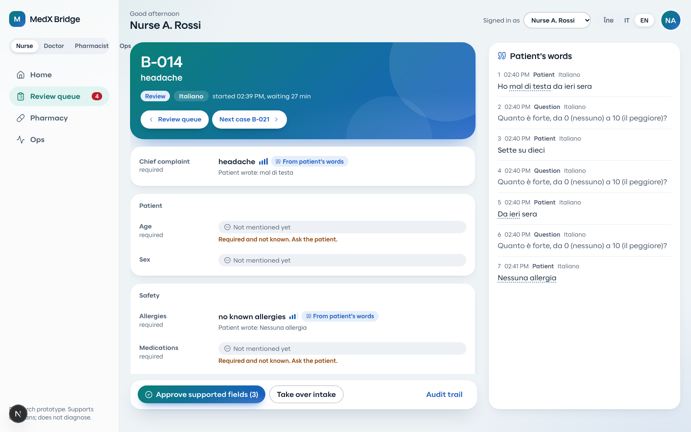
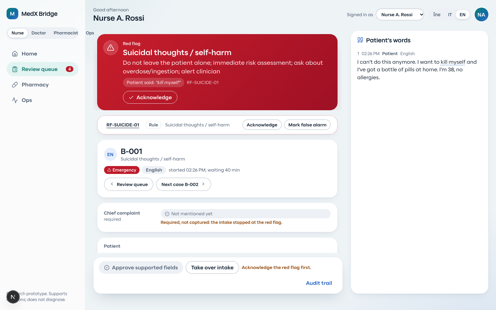
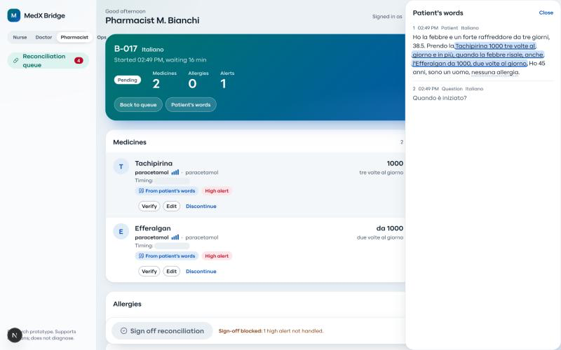
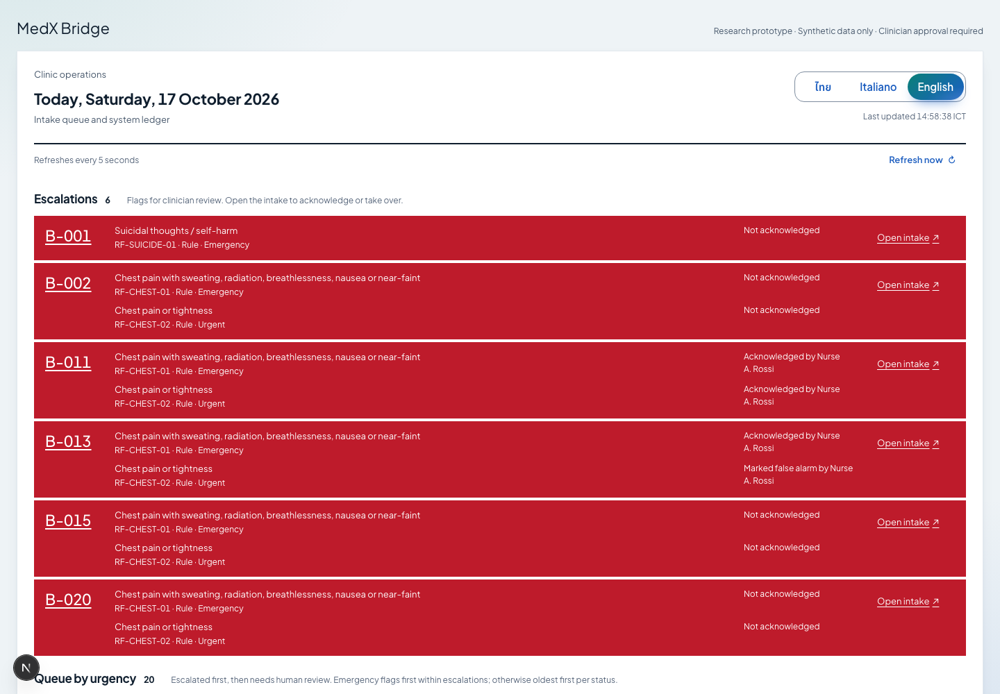
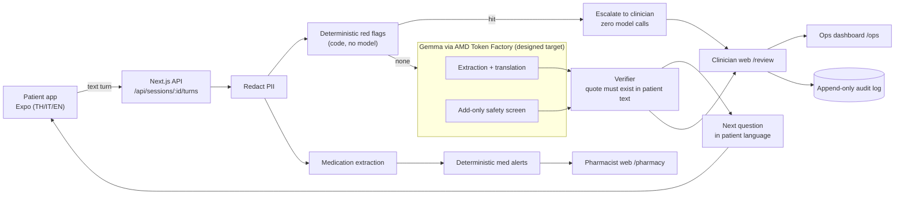

# MedX Bridge

Multilingual pre-visit intake where **every field points back to the patient's own words**. A patient describes the problem in Thai, Italian or English; the nurse gets a one-screen summary in her own language where **every field links to the exact patient sentence it came from**, unverified fields are shown as unsupported (never as fact), missing information triggers one follow-up question back to the patient, and red flags interrupt everything. Pharmacists get the same treatment for medication lists (extraction plus deterministic drug-safety alerts). Designed to run Gemma on AMD via the hackathon's AMD Token Factory (OpenAI-compatible); current results use a mock model until the endpoint is connected.

AMD Developer Hackathon ACT III, Track 2 (Health and Wellbeing).

> **Claim boundary.** Research prototype and clinical decision support. It *supports* clinicians and *flags for review*; it never diagnoses, treats, prescribes or decides urgency on its own. **Synthetic data only**, not clinically validated, not a medical device.

## Screenshots

| Patient app (Expo) | Red flag (Thai) | Clinician review |
|---|---|---|
|  |  |  |

| Escalated case | Pharmacist | Ops |
|---|---|---|
|  |  |  |

## How it works



1. Raw patient text is redacted before storage or any model call.
2. Red-flag rules are plain code and run first; no model output can clear a hit.
3. Gemma (extraction and translation) and a Gemma safety screen run in parallel. The screen can only **add** a flag, needs a verified quote, and a clinician confirms it.
4. The verifier checks every quote against the patient's own text. No verified quote means `unsupported`.
5. Provider failure, schema failure or low confidence means abstain and "needs human review". Nothing is final until a clinician approves; every action is audit-logged.

Details: [docs/ARCHITECTURE.md](docs/ARCHITECTURE.md). Safety answers to the five Track 2 questions: [pitch/SAFETY.md](pitch/SAFETY.md).

## How AMD is used

All model calls (extraction, translation, safety screen, next question, medication extraction) go to **Gemma via the hackathon's AMD Token Factory** (designed target; current results use a mock model until the endpoint is connected), via its OpenAI-compatible `chat/completions` API (JSON-schema structured output, per-call timeout, one fallback model, one repair retry). Provider specifics live in one file, `apps/web/lib/pipeline/llm.ts`; the API key is read server-side from the environment and never reaches a client. Set `MODEL_PROVIDER=mock` to run everything offline with a deterministic stand-in (used for tests, CI and key-less demos; the UI and `/api/health` label it honestly as `mock`). Design notes: [docs/ai/DESIGN.md](docs/ai/DESIGN.md).

## Quick start

**Docker (one-liner, no key needed):**

```bash
docker build -f apps/web/Dockerfile -t medx-bridge . \
 && docker run --rm -p 3000:3000 -e MODEL_PROVIDER=mock -e DEMO_SEED=1 medx-bridge
# open http://localhost:3000, then seed demo data (server started with DEMO_SEED=1 and DEMO_TOKEN):
#   curl -X POST -H "x-demo-token: $DEMO_TOKEN" localhost:3000/api/demo/reset
```

With Gemma on AMD: `cp .env.example .env`, fill `AMD_*`, set `MODEL_PROVIDER=amd`, then `docker compose --env-file .env up --build`.

**Local dev:**

```bash
npm --prefix apps/web install
npm --prefix apps/web run dev            # http://localhost:3000  (/review /pharmacy /ops)
cd apps/mobile && npm install && npx expo start   # patient app; press w for web, i for iOS simulator
```

On a physical phone set `EXPO_PUBLIC_API_URL=http://<your-LAN-ip>:3000` before `expo start`.

**Patient app served by the web app at `/patient`** (for the hosted demo):

```bash
scripts/build-patient-web.sh     # expo export -> apps/web/public/patient
```

Run it before `docker build` / deploy (the output is a build artifact, not committed to be hand-edited).

## Environment variables

| Variable | Purpose |
|---|---|
| `MODEL_PROVIDER` | `amd` (Gemma on AMD Token Factory) or `mock` (deterministic, offline) |
| `AMD_BASE_URL` | OpenAI-compatible base URL from the Token Factory console, ending in `/v1` |
| `AMD_API_KEY` | Bearer key, server-side only, never committed |
| `AMD_MODEL` | Primary Gemma model id, exactly as `GET {AMD_BASE_URL}/models` returns it |
| `AMD_MODEL_FALLBACK` | Optional second Gemma id used on provider error |
| `DEMO_SEED` | `1` enables `POST /api/demo/reset` (synthetic fixtures); leave unset outside demos |
| `DEMO_TOKEN` | secret required in the `x-demo-token` header for demo reset/seed; reset is disabled when unset |
| `LLM_TIMEOUT_MS` | Per-call timeout; defaults 25000 ms (extraction) and 8000 ms (next question) |

Also: `AMD_JSON_SCHEMA=false` disables `response_format` json_schema if an endpoint rejects it; `MEDX_STORE_PATH` sets the JSON store file (Docker default `/app/apps/web/.data/store.json`). See [.env.example](.env.example).

## Tests

```bash
npm --prefix apps/web test      # vitest: 1,043 tests in 13 files (red flags, redaction, verifier, med rules, API, ops metrics)
```

## Evaluation

Synthetic benchmark of 52 cases (40 intake + 12 medication) plus an 18-case blind red-flag holdout, metrics pre-declared in [docs/ai/METRICS.md](docs/ai/METRICS.md):

```bash
cd apps/web && MODEL_PROVIDER=mock npx vite-node ../../eval/run.ts -- --split all
```

Results are written to `eval/REPORT.md` (failures and unmet thresholds included). **Read the banner at the top of that report: a mock run proves the harness only, it is not evidence about Gemma.** We do not quote numbers here; see [eval/REPORT.md](eval/REPORT.md).

## Safety design (summary)

Unsupported claims are shown as pencil, not fact; PII redacted before storage or model use; uncertainty makes the system abstain; high-risk rules are code the model cannot override; a clinician approves everything. Full mapping in [pitch/SAFETY.md](pitch/SAFETY.md) and [docs/ARCHITECTURE.md](docs/ARCHITECTURE.md).

## Repo map

| Path | What | Team role |
|---|---|---|
| `apps/web` | Next.js 15: clinician `/review`, pharmacist `/pharmacy`, ops `/ops`, and every API route | AI engineer, web builders |
| `apps/web/lib/pipeline` | Redaction, red flags, med rules, Gemma client, extraction, verifier, audit store | AI engineer |
| `apps/mobile` | Expo patient app (iOS, Android, web) | Patient mobile builder |
| `packages/shared` | Contracts (`types.ts`, `api.ts`), design tokens, `redflags.json`, `medrules.json` | Orchestrator, Doctor |
| `data/cases`, `data/holdout` | Synthetic multilingual cases with gold labels | Medical researcher |
| `eval` | Harness and `REPORT.md` | AI researcher |
| `docs` | Clinical spec, AI design, design direction, research, per-wave reports | Doctor, AI researcher, Design lead |
| `pitch` | Deck outline, safety answers, video script, cover | Pitch lead |

## Team

[TEAM NAMES]

## License

MIT, see [LICENSE](LICENSE).
