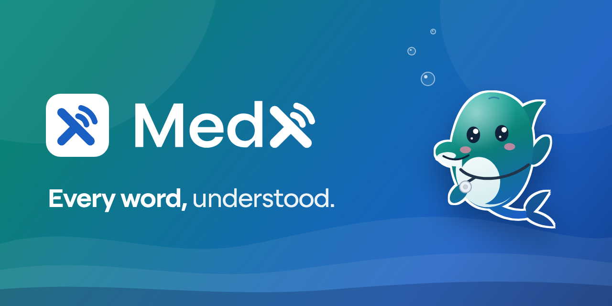
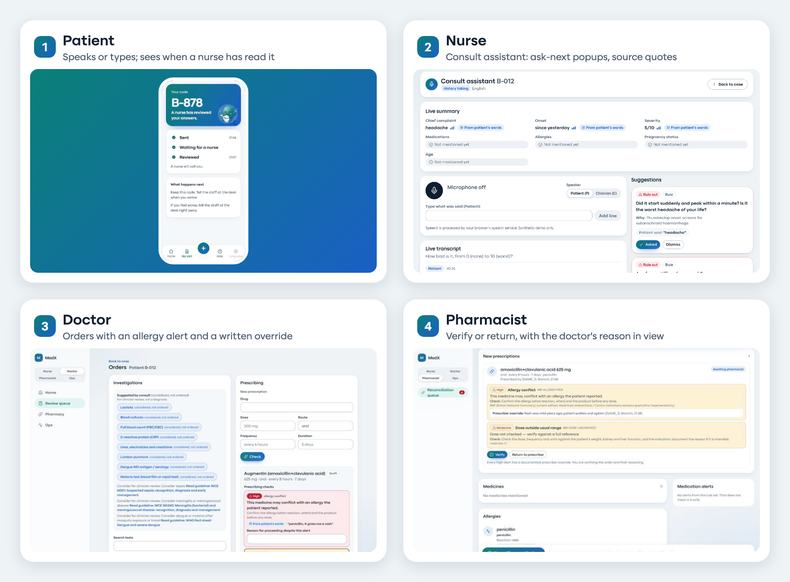
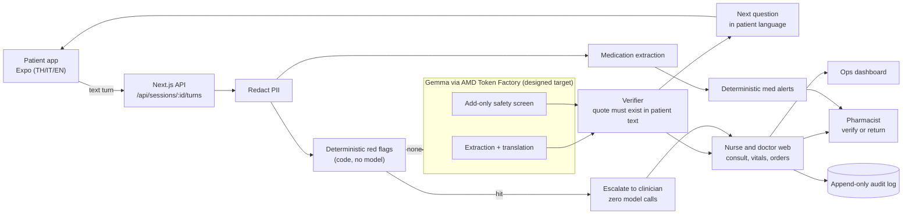

<p align="center">
  
</p>

<h3 align="center">Every word, understood.</h3>

<p align="center">
  A multilingual care journey, from the patient's own words to the pharmacy.<br>
  Every field points back to what the patient said.
</p>

<p align="center">
  
  
  
  
  
  
  
</p>

<p align="center">
  <b>Live demo:</b> [URL pending] &nbsp;·&nbsp;
  <a href="pitch/deck/MedX-deck.pdf"><b>Deck (PDF)</b></a> &nbsp;·&nbsp;
  <b>Video:</b> [pending] &nbsp;·&nbsp;
  <a href="HANDOFF.md"><b>HANDOFF.md</b></a> &nbsp;·&nbsp;
  <a href="pitch/SAFETY.md"><b>Safety answers</b></a>
</p>

> **Claim boundary.** Research prototype and clinical decision support. The AI never diagnoses, orders, prescribes or confirms triage; clinicians do these in MedX, with deterministic checks and an audit trail. **Synthetic data only**, not clinically validated, not a medical device.

---

## Why

- **Language gaps cause harm.** In six US hospitals, adverse events in limited-English patients involved physical harm in 49.1% of cases versus 29.5% for English speakers; communication errors caused 52.4% versus 35.9% (Divi et al., *Int J Qual Health Care* 2007). [Sources](docs/research/PROBLEM.md)
- **Medicine lists are often wrong.** Across six pharmacist-checked studies, 13% to 59% of patients had at least one unintended error in their admission medication list; omission was the commonest type. Settings differ, so a range is shown. [Sources](docs/research/PHARMACY-PROBLEM.md)
- **Clinicians have little time to read.** Doctors spent 49.2% of the office day on EHR and desk work against 27.0% on direct face time (Sinsky et al., *Ann Intern Med* 2016).

## What it does

One patient, four roles, one trail back to the patient's own words.

<p align="center">
  
</p>

| Role | What MedX gives them |
|---|---|
| **1. Patient** (Thai, Italian, English) | Guided intake by voice or text. A voice agent reads each question aloud, and the patient checks the transcript before sending. A live status shows when a nurse has read the answers. |
| **2. Nurse** | Consult assistant for history-taking: ambient listening, "ask next" and "rule out" question popups, a live summary where each field links to the patient's sentence. Vitals produce a NEWS2-based triage **suggestion** that the nurse confirms. |
| **3. Doctor** | Doctor-only "considerations" for clinical judgement (labelled "not a diagnosis", with guideline links, from a fixed curated list); an evidence-linked draft note the doctor signs; orders with deterministic checks (allergy, interaction, duplicate, pregnancy, dose range) and a written reason to override a high alert. |
| **4. Pharmacist** | Verifies or returns each prescription with a note, with the doctor's reason in view, and reconciles the medicines the patient named (brand to generic). |
| Clinic manager | Ops dashboard: queue by urgency, escalations, abstain rate, and an honest model label. |
| **Every case** | **Case trace**: the executed graph of how this case was handled (rule checks, model calls, skipped steps, human decisions) with evidence per step, JSON export and a deterministic replay check (audit digest). A red-flag case stops before any model call; a medication case branches into the prescribing checks. |

<p align="center"> &nbsp; Fin the dolphin is the mascot: a helper that listens closely, never the decider.</p>

## Safety by design

- **Red flags are code, not a model.** 18 deterministic, guideline-sourced rules run on the raw text before any model call and cannot be cleared by one. A hit stops the intake and interrupts the clinician screen.
- **Add-only Gemma screen.** It can raise a flag with a verified quote ("model-suggested, confirm"); it can never clear one. On an 18-case synthetic blind holdout, keyword rules alone caught **7 of 10** emergencies (3 of 8 false alarms), which is why the screen exists.
- **No quote, no fact.** Every field must carry a quote from the patient's text, checked by code. Without it the field shows "needs check".
- **Abstain, don't guess.** Provider error, schema error or low confidence gives "needs human review".
- **People decide.** Triage is a suggestion the nurse confirms. The AI never proposes drugs or doses; the doctor enters orders; high alerts need a written reason; a pharmacist verifies or returns.
- **Auditable.** Nothing is final until a clinician approves; every action goes to an append-only audit log.

Mapped to the five Track 2 questions, with code paths: [pitch/SAFETY.md](pitch/SAFETY.md).

## Architecture



Details: [docs/ARCHITECTURE.md](docs/ARCHITECTURE.md).

## How AMD is used

All model calls (extraction, translation, safety screen, next question, medication extraction) are designed to go to **Gemma via the hackathon's AMD Token Factory**, through its OpenAI-compatible `chat/completions` API (JSON-schema output, per-call timeout, one fallback model, one repair retry). Provider specifics live in one file, `apps/web/lib/pipeline/llm.ts`; the key is read server-side from the environment. **Current results use a mock model until the endpoint is connected** (`MODEL_PROVIDER=mock`); the UI and `/api/health` label it honestly. Gemma accuracy and latency on AMD are **[pending AMD run]**. Design notes: [docs/ai/DESIGN.md](docs/ai/DESIGN.md).

## Quick start

```bash
git clone https://github.com/KingPhuripol/MedX-AI.git && cd MedX-AI
npm --prefix apps/web install
cd apps/web && MODEL_PROVIDER=mock DEMO_SEED=1 DEMO_AUTOSEED=1 DEMO_TOKEN=pick-a-secret npm run dev
# open http://localhost:3000  (synthetic demo cases are seeded automatically)
# reset demo data:
#   curl -X POST -H "x-demo-token: pick-a-secret" localhost:3000/api/demo/reset
```

Pages: `/` · `/review` (nurse, doctor) · `/review/<id>/consult?mode=nurse|doctor` · `/review/<id>/vitals` · `/review/<id>/orders` · `/pharmacy` · `/ops` · `/patient/` (patient app, web build).

**Patient app (native):** `cd apps/mobile && npm install && npx expo start` (press `w` for web, `i` for the iOS simulator). On a phone set `EXPO_PUBLIC_API_URL=http://<your-LAN-ip>:3000` first. To serve the web build from the Next app: `scripts/build-patient-web.sh`.

**Docker, no key needed:**

```bash
docker build -f apps/web/Dockerfile -t medx . \
 && docker run --rm -p 3000:3000 -e MODEL_PROVIDER=mock -e DEMO_SEED=1 -e DEMO_AUTOSEED=1 -e DEMO_TOKEN=pick-a-secret medx
```

**With Gemma on AMD:** `cp .env.example .env`, fill `AMD_*`, set `MODEL_PROVIDER=amd`, then `docker compose --env-file .env up --build`.

<details>
<summary><b>Environment variables</b></summary>

| Variable | Purpose |
|---|---|
| `MODEL_PROVIDER` | `amd` (Token Factory) or `mock` (deterministic, offline) |
| `AMD_BASE_URL` | OpenAI-compatible base URL from the Token Factory console, ending in `/v1` |
| `AMD_API_KEY` | Bearer key, server-side only, never committed |
| `AMD_MODEL` | Primary Gemma model id, exactly as `GET {AMD_BASE_URL}/models` returns it |
| `AMD_MODEL_FALLBACK` | Optional second Gemma id used on provider error |
| `DEMO_SEED` | `1` enables `POST /api/demo/reset` (synthetic fixtures); leave unset outside demos |
| `DEMO_AUTOSEED` | `1` seeds the synthetic demo cases on first start |
| `DEMO_TOKEN` | Secret required in the `x-demo-token` header for demo reset and seed; reset is disabled when unset |
| `LLM_TIMEOUT_MS` | Per-call timeout; defaults 25000 ms (extraction) and 8000 ms (next question) |

Also: `AMD_JSON_SCHEMA=false` disables `response_format` json_schema if an endpoint rejects it; `MEDX_STORE_PATH` sets the JSON store file. See [.env.example](.env.example).
</details>

## Tests and evaluation

```bash
npm --prefix apps/web test      # vitest: 1,872 tests in 23 files
node docs/clinical/check-redflags.mjs   # 175 red-flag reference tests (also check-medrules, check-consultrules)
cd apps/web && MODEL_PROVIDER=mock npx vite-node ../../eval/run.ts -- --split all
```

- **Data:** 52 synthetic cases (40 intake + 12 medication) and an 18-case blind red-flag holdout; metrics pre-declared in [docs/ai/METRICS.md](docs/ai/METRICS.md).
- **Honest reporting:** `eval/REPORT.md` includes failures and unmet thresholds. A mock run proves the harness only; it is not evidence about Gemma. Holdout keyword-rules result: [eval/results/holdout-rules-only.md](eval/results/holdout-rules-only.md).

## Repo map

| Path | What |
|---|---|
| `apps/web` | Next.js 15: nurse and doctor `/review`, `/pharmacy`, `/ops`, and every API route |
| `apps/web/lib/pipeline` | Redaction, red flags, consult, vitals and triage, orders, med rules, Gemma client, verifier, audit store |
| `apps/mobile` | Expo patient app (iOS, Android, web) |
| `packages/shared` | Contracts, design tokens, `redflags.json`, `medrules.json`, `consultrules.json`, `vitalrules.json` |
| `data/cases`, `data/holdout` | Synthetic multilingual cases with gold labels |
| `eval` | Evaluation harness and report |
| `docs` | Clinical spec, AI design, design direction, research, per-wave reports, decisions |
| `pitch` | Deck, cover, video script, submission copy, safety answers |

## Limitations & safety

Research prototype that supports clinicians; the AI never diagnoses, orders, prescribes or confirms triage. Synthetic data only; not clinically validated, not a medical device. Red-flag rules run before any model and cannot be cleared by it, but miss paraphrases (7/10 emergencies on an 18-case synthetic holdout). The consult assistant's doctor-only "consider" items come from a fixed 12-presentation list, not a complete differential. The NEWS2 triage level is a suggestion for adults (not pregnancy); the nurse confirms. Prescribing checks use a small rule set (59 drugs, 18 interactions, adult dose ceilings for 31) and miss what it lacks. Speech goes to the browser's or phone's cloud speech service. Redaction is imperfect; reviewer identity is self-declared; Gemma-on-AMD is unmeasured (mock model).

## Team MedX

Built for the AMD Developer Hackathon ACT III. A human lead orchestrated Claude (Opus and Sonnet) and OpenAI Codex agents in role-based lanes (clinical, research, AI, design, web, mobile, pitch). Work was cross-reviewed across vendors: Claude reviewed the Codex engine, Codex reviewed the UI, with QA, UX and clinical-safety reviews; findings were fixed under regression tests. Decisions and reports: [docs/DECISIONS.md](docs/DECISIONS.md), [docs/reports/](docs/reports).

## License

MIT, see [LICENSE](LICENSE). The SCBXBeta2 font files are not part of the MIT grant.

<p align="center"><sub>MedX · research prototype · synthetic data only</sub></p>
