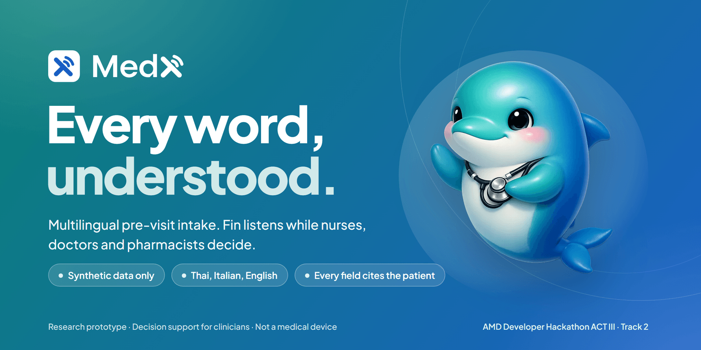
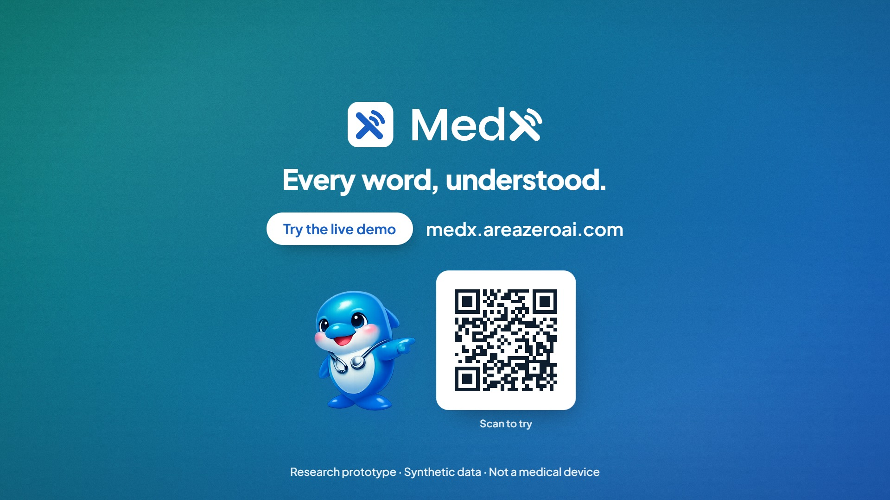
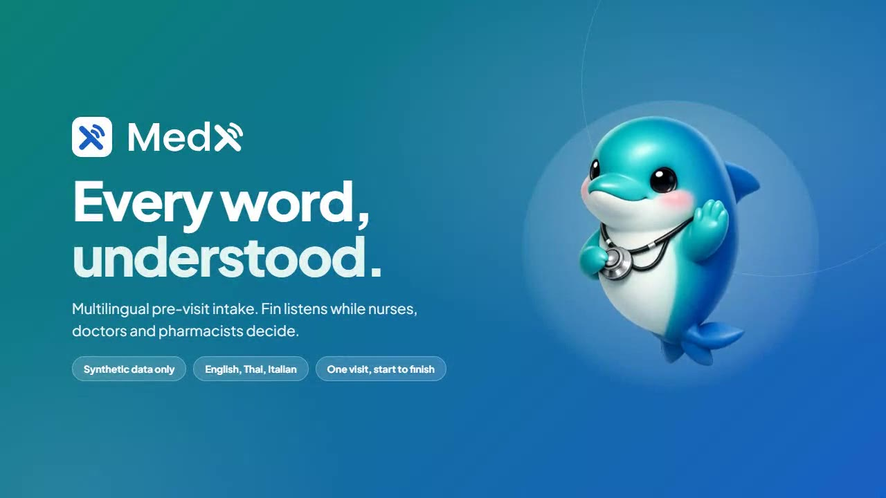
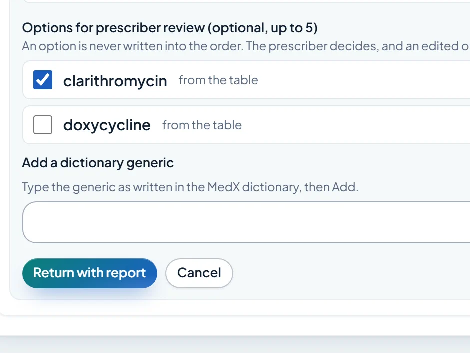
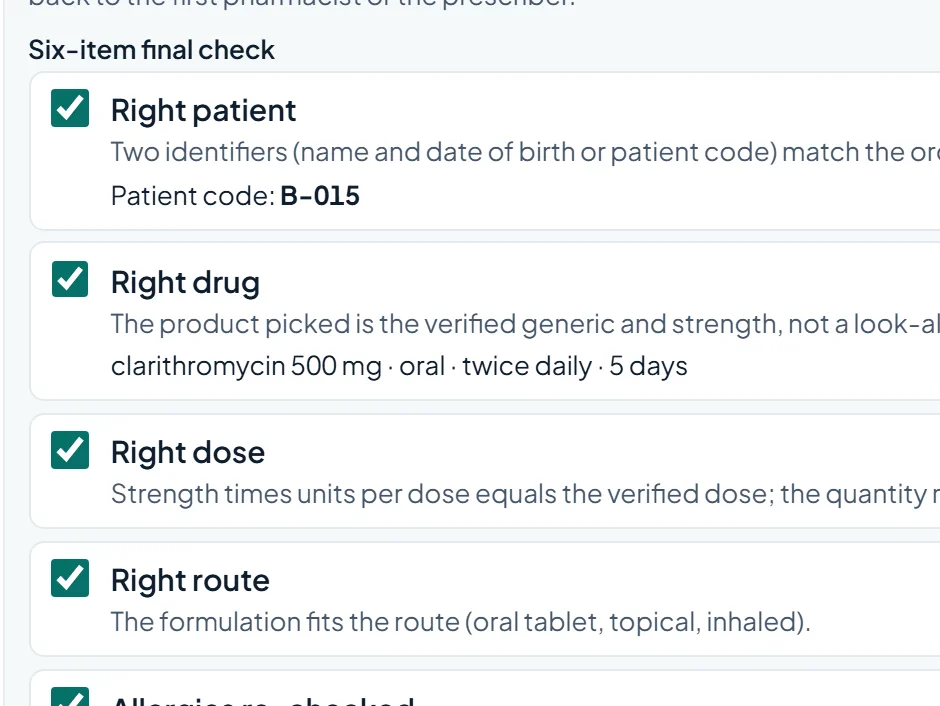
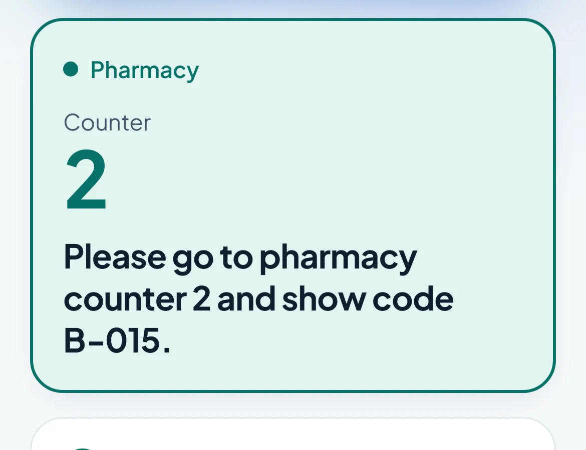
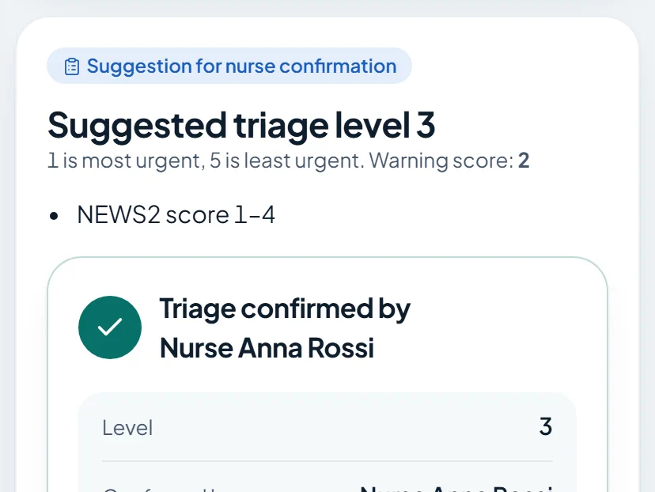
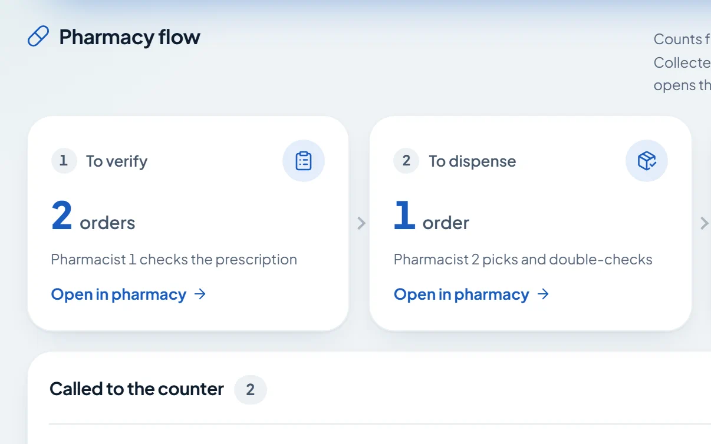
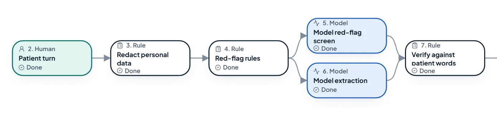
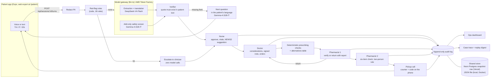

<p align="center">
  <a href="https://medx.areazeroai.com"></a>
</p>

<h3 align="center">Multilingual AI copilot for clinic visits. Every word, understood.</h3>

<p align="center">
  Multilingual pre-visit intake and care journey, from the patient's own words to the pharmacy counter.<br>
  Patients speak Thai, Italian or English. Every field cites what they said. Red flags are code. People decide.
</p>

<p align="center">
  <a href="https://medx.areazeroai.com"></a>
  <a href="#watch"></a>
</p>

<p align="center">
  
  
  
  
  
  
  
  
  
</p>

<p align="center">
  <a href="https://medx.areazeroai.com"><b>Live demo</b></a> &nbsp;·&nbsp;
  <a href="#watch"><b>Videos</b></a> &nbsp;·&nbsp;
  <a href="#try-it-in-2-minutes"><b>Try it in 2 minutes</b></a> &nbsp;·&nbsp;
  <a href="pitch/deck/MedX-deck.pdf"><b>Deck (PDF)</b></a> &nbsp;·&nbsp;
  <a href="pitch/SAFETY.md"><b>Safety answers</b></a> &nbsp;·&nbsp;
  <a href="docs/DEPLOY.md"><b>Deploy guide</b></a> &nbsp;·&nbsp;
  <a href="HANDOFF.md"><b>Handoff</b></a>
</p>

> [!IMPORTANT]
> **Claim boundary.** MedX is a research prototype and decision support for clinicians. It suggests for review and flags for the clinician. It never diagnoses, treats, prescribes or decides urgency: nurses, doctors and pharmacists do those things in MedX, with deterministic checks and an append-only audit trail. **Synthetic data only.** Not clinically validated, not a medical device. Do not enter real patient information.

---

## Contents

[Watch](#watch) · [Try it in 2 minutes](#try-it-in-2-minutes) · [Why](#why) · [The journey](#the-journey) · [Safety by design](#safety-by-design) · [Architecture](#architecture) · [Tech stack](#tech-stack) · [Design](#design) · [Quick start](#quick-start) · [Deploy on Vercel](#deploy-on-vercel) · [Environment variables](#environment-variables) · [Tests and evaluation](#tests-and-evaluation) · [Project structure](#project-structure) · [Limitations](#limitations) · [Team](#team) · [License](#license)

## Watch

<table>
  <tr>
    <td width="50%" valign="top">
      <a href="https://medx.areazeroai.com/media/medx-promo-voice.mp4"></a>
      <p><b>The 60-second film (English voice-over over an original score).</b> The story: a Thai patient line, the language-gap statistic, the care journey through every role, and the safety beats. 1080p60 with an original score.<br>
      <a href="https://medx.areazeroai.com/media/medx-promo-voice.mp4">Watch on the live site</a> · <a href="apps/web/public/media/medx-promo-voice.mp4">file in this repo</a> (19.6 MB)</p>
    </td>
    <td width="50%" valign="top">
      <a href="https://medx.areazeroai.com/media/medx-demo-narrated.mp4"></a>
      <p><b>The narrated product walkthrough (2 min 15 s, English voice-over).</b> One synthetic visit, recorded click by click in the real UI: patient, nurse, doctor, pharmacist 1, pharmacist 2, pickup, ops and the case trace. English captions.<br>
      <a href="https://medx.areazeroai.com/media/medx-demo-narrated.mp4">Watch on the live site</a> · <a href="apps/web/public/media/medx-demo-narrated.mp4">file in this repo</a> (8.3 MB) · <a href="apps/web/public/media/medx-demo-narrated.en.vtt">captions</a></p>
    </td>
  </tr>
</table>

The narrated walkthrough was recorded on the deterministic mock model for reproducibility, so its model label reads "mock model, not AMD"; the live site runs on the AMD Token Factory (check `/api/health`). The film source lives in [`pitch/promo/`](pitch/promo/README.md) (re-render steps in its README), and the walkthrough re-records from the running app with `scripts/record-demo.mjs`.

## Try it in 2 minutes

Open **[medx.areazeroai.com](https://medx.areazeroai.com)**, scroll to **Try a role** (or go straight to [/demo](https://medx.areazeroai.com/demo)) and pick a person. Each card signs you in as that synthetic person: the nurse, doctor and pharmacist cards open a fresh synthetic case at that person's step, the operations card opens the dashboard, and the patient card opens a fresh intake. The six roles come from `DEMO_PERSONAS` in [`packages/shared/src/demo.ts`](packages/shared/src/demo.ts).

| Role | You are | Your case starts at | Try this | Opens |
|---|---|---|---|---|
| **Patient** | The patient (no staff identity) | Intake | Tell Fin what brings you in, by voice or text, in English, Thai or Italian. Pick a "Try saying" example, check the words, send, and keep the visit code. | `/patient/?new=1` |
| **Nurse** | Nurse Anna Rossi | Intake | Review the intake: click a field to see the patient's own sentence, approve the supported fields, record vitals and confirm the NEWS2-based triage suggestion. | `/review/<id>` |
| **Doctor** | Dr. Marco Bianchi | Ready for doctor | Run the consult, keep a rule-based consideration (labelled "not a diagnosis"), sign the note, then prescribe amoxicillin and watch the deterministic penicillin-allergy alert. | `/review/<id>/consult?mode=doctor` |
| **Pharmacist 1 (verify)** | Pharmacist Laura Conti | Pharmacy check | Check the prescription, then verify it, or return it with a report and options for prescriber review. | `/pharmacy/<id>` |
| **Pharmacist 2 (dispense)** | Pharmacist Nattaya Wong | Dispensing | Do the six-item final check (the pharmacist who verified cannot dispense), dispense, and call the patient to the counter. | `/pharmacy/<id>` |
| **Clinic operations** | Head Nurse Elena Greco | Ready to collect | Watch the queue, escalations, abstentions and the pharmacy pipeline, with the live model label. | `/ops` |

Good to know:
- Scan the QR on the landing page to open the patient app on a phone. Phone and web read and write the same case.
- Every staff page has an account menu: **Signed in as**, a **Demo identity · synthetic staff** chip, **Switch role** (back to `/demo`) and **Sign out**. A staff page opened with no identity shows a **"Who's signing in?"** sheet; reading works, but every write waits until you choose a synthetic staff member. There are no real accounts or passwords; identity is self-declared.
- On the patient app, **Start a new visit** clears the visit from this phone only (the care team keeps what was sent), so a shared phone is ready for the next person.
- The public demo resets every day at 03:00 ICT. Demo cases and their audit log are cleared.

## Why

Published research, not MedX results. Sources: [docs/research/PROBLEM.md](docs/research/PROBLEM.md) and [docs/research/PHARMACY-PROBLEM.md](docs/research/PHARMACY-PROBLEM.md).

| | Finding | Source |
|---|---|---|
| **49.1% vs 29.5%** | In six US hospitals, adverse events in patients with limited English involved physical harm in 49.1% of cases, against 29.5% for English speakers. Communication errors caused 52.4% of their events, against 35.9%. | Divi et al., *Int J Qual Health Care* 2007, PMID 17277013 |
| **13% to 59%** | Across six pharmacist-checked studies, 13% to 59% of patients had at least one unintended error in their admission medicine list; omission was the most common. Settings differ, so a range is shown. | Studies M1 to M6 in the research notes |
| **49.2% vs 27.0%** | Doctors spent 49.2% of the office day on EHR and desk work, against 27.0% on direct face time with patients. | Sinsky et al., *Ann Intern Med* 2016, PMID 27595430 |
| **32.97 million** | Foreign tourist arrivals in Thailand in 2025. Any of them can reach a clinic where the staff do not share their language. | Ministry of Tourism and Sports, via Bernama, 6 Jan 2026 |

## The journey

One synthetic visit, eight steps, one record. Each screen below is a real capture from the current build.

<p align="center">
  
</p>

| Step | Who | What MedX gives them | What a person decides |
|---|---|---|---|
| 1 | **Patient** | Guided intake by voice or text in Thai, Italian or English. A voice agent reads each question aloud; the patient checks the transcript before sending. One follow-up for each missing item, then a visit code and a live status: sent, seen by the care team, reviewed, preparing your medicine, ready to collect. | The patient checks every word before it is sent. |
| 2 | **Nurse** | A summary where every field links to the patient's sentence (the evidence highlights in the transcript). A consult assistant listens during history-taking (after a recorded consent step) and pops up "ask next" and "rule out" questions. Vitals give a NEWS2-based triage **suggestion** for adults. | The nurse approves or edits each field and confirms or changes the triage level. |
| 3 | **Doctor** | Doctor-only "considerations" from a fixed curated list of 51 rules over 12 presentations, labelled not a diagnosis, with guideline links. A draft visit note built from the patient's words; anything without evidence says "Needs check". | The doctor keeps or dismisses each consideration, edits and signs the note. |
| 4 | **Doctor: orders** | Investigation and medication orders with deterministic checks: allergy, interaction, duplicate, pregnancy and dose range (59 drugs, 18 interactions, adult dose ceilings for 31). A high alert lists **options to review** from a sourced alternatives table, each re-checked against this patient. | The doctor writes every order. A high alert needs a written reason. An option is never written into the order by the system. |
| 5 | **Pharmacist 1: verify or return** | The order, its checks, the prescriber's override reasons and the patient's own medicine list. A return carries a report: the flagged alert ids and up to five dictionary generics as options for prescriber review. | Pharmacist 1 verifies, or returns with a note. The doctor edits, keeps or cancels, and every edit is checked again from scratch. |
| 6 | **Pharmacist 2: dispense** | A six-item final check (right patient, drug, dose, route, allergies re-checked, labelled), every box unticked to start. A new high alert on a dispensed, uncollected order sends it back to pharmacist 1. | A second pharmacist dispenses. The server refuses the pharmacist who verified (two-person check) and any partial checklist. |
| 7 | **Pickup** | The pharmacist calls the patient to a counter. The phone shows "Please go to pharmacy counter 2 and show code B-015", never drug names, alerts or notes. | The pharmacist confirms identity at the counter and records the collection. |
| 8 | **Ops and case trace** | Ops: queue by urgency, escalations, abstain rate, the pharmacy pipeline (to verify, to dispense, ready, collected today) and the honest model label. Case trace: the executed graph of one case (rule checks, model calls, skipped steps, human decisions) with evidence per step, JSON export and a deterministic replay digest. | The clinic manager reads counts only; nothing on ops changes a case. |

<table>
  <tr>
    <td width="33%" valign="top"><br><sub><b>Pharmacist 1.</b> Return with a report and options for prescriber review.</sub></td>
    <td width="33%" valign="top"><br><sub><b>Pharmacist 2.</b> Six-item final check; the verifier cannot dispense.</sub></td>
    <td width="33%" valign="top"><br><sub><b>Pickup.</b> The phone shows the counter and the code, nothing clinical.</sub></td>
  </tr>
  <tr>
    <td width="33%" valign="top"><br><sub><b>Nurse.</b> A NEWS2-based suggestion the nurse confirms.</sub></td>
    <td width="33%" valign="top"><br><sub><b>Ops.</b> Pharmacy flow and queue, counts only.</sub></td>
    <td width="33%" valign="top"><br><sub><b>Case trace.</b> Rules before models, every step on the record.</sub></td>
  </tr>
</table>

<p align="center"> &nbsp; <b>Fin the dolphin</b> is the mascot: a helper who listens while people decide. Fin never appears next to red flags, alerts, errors or clinical content.</p>

## Safety by design

**Fin prepares. People decide.** These rules hold in every build, and tests fail if one breaks. They map to the five Track 2 safety questions in [pitch/SAFETY.md](pitch/SAFETY.md), with code paths.

1. **Red flags are code, not a model.** 18 deterministic, guideline-sourced rules ([`redflags.json`](packages/shared/src/redflags.json)) run on the raw text before any model call. A hit stops the intake with zero model calls, shows the patient a calm "go to the desk" screen and interrupts the clinician screen. No model output can clear it.
2. **Add-only model screen.** A model safety screen can raise a flag with a verified quote ("model-suggested, confirm"); it can never clear one. On an 18-case synthetic blind holdout, keyword rules alone caught 7 of 10 emergencies with 3 of 8 false alarms, which is why the screen exists. With the Gemma screen on the AMD Token Factory: 8 of 10 (it alone caught the suicide-risk case), false alarms unchanged; the 9 of 10 target is not met.
3. **No quote, no fact.** Every extracted field must carry a quote from the patient's own text, checked by code. Without one the field is `unsupported`, shown as "Needs check", never as fact.
4. **Abstain, do not guess.** A provider error, a schema error or low confidence gives "needs human review", never a guess.
5. **People decide, on the record.** Triage is a suggestion the nurse confirms. The AI never proposes drugs or doses. The doctor enters orders; high alerts need a written reason; pharmacist 1 verifies or returns; pharmacist 2 dispenses after a two-person check. Nothing is final until a clinician approves, and every action goes to an append-only audit log with who did it.
6. **Redact first.** Names, phone numbers, ID and passport numbers become tokens before storage or any model call. Staff names typed into actor fields are kept only when they are known synthetic staff; anything else is redacted.
7. **Keys stay on the server.** API keys and database URLs come from environment variables only. `/api/health` reports facts (provider, model, store, commit) and never a credential.
8. **Built for a public URL.** Content-Security-Policy and security headers on every route, a per-IP POST rate limit, 64 kB JSON body cap, constant-time secret checks, and role checks on clinical writes (`MEDX_STRICT_ROLES=1` in production).

## Architecture



- **One backend.** `apps/web` (Next.js 15) serves the landing page, the staff web app and every API route. The patient app is the Expo app in `apps/mobile`, exported for the web to `apps/web/public/patient` so the demo needs no install.
- **Shared store.** On Vercel, instances share one Neon serverless Postgres row (`medx_store`, created on first use) holding the whole snapshot, written with optimistic concurrency: `UPDATE ... WHERE id = $1 AND version = $2`, then re-read, merge or replay on conflict, and 503 "Store busy, retry" after five retries. Per-session locks use a version check, not only in-process locks. Locally, in Docker and on Render the store is a JSON file. Any store error fails closed with 503, never a silent fallback.
- **Journey stage.** Every queue and header shows a neutral stage derived from the record only (`packages/shared/src/journey.ts`): Intake, Intake reviewed, Triaged, Ready for doctor, Doctor signed, Orders sent, Pharmacy check, Dispensing, Ready to collect, Collected. It never decides urgency.

Details: [docs/ARCHITECTURE.md](docs/ARCHITECTURE.md) · spec of record: [docs/SPEC.md](docs/SPEC.md).

## Tech stack

| Layer | What we use |
|---|---|
| Web app and API | Next.js 15.5 (App Router), React 19, TypeScript strict, Tailwind CSS v4 |
| Patient app | Expo SDK 58, React Native 0.88, Expo Router, Reanimated 4, expo-speech and expo-speech-recognition (cloud speech of the phone or browser) |
| Shared contracts | `packages/shared`: types, API shapes, design tokens, demo personas, journey stages, and the clinical rule files (`redflags.json`, `medrules.json`, `consultrules.json`, `vitalrules.json`, `investigations.json`) |
| Store | Neon serverless Postgres over HTTP (`@neondatabase/serverless`) on the public demo; optional Upstash Redis REST; JSON file locally |
| Model | **Live demo: the hackathon's AMD Token Factory** (OpenAI-compatible, `MODEL_PROVIDER=amd`; `/api/health` reports `provider: "amd-tokenfactory"`, `model: "Gemma-4-31B-IT"`, `extractModel: "DeepSeek-V4-Flash"`, `hardware: "AMD (via Token Factory)"`). **Gemma-4-31B-IT** runs the add-only red-flag screen and the next question; **DeepSeek-V4-Flash** (`AMD_EXTRACT_MODEL`) runs the long structured extraction. Why two models: on the shared endpoint during the event, Gemma-4-31B-IT took 72 s and 300 s for one ~880-output-token extraction under strict JSON schema, beyond the 60 s request budget of a serverless route, while short Gemma calls answer in a few seconds; DeepSeek-V4-Flash on the same Token Factory returned schema-valid extraction in 17 to 48 s. One OpenAI-compatible client (`apps/web/lib/pipeline/llm.ts`) with JSON-schema output, per-call timeouts inside a 52 s turn deadline, retries on HTTP 429 with a capped Retry-After, one repair retry and an optional fallback model. Every model call records its model id in the audit trail and the Case trace. Local runs default to a deterministic mock (`MODEL_PROVIDER=mock`). Measured results: [Tests and evaluation](#tests-and-evaluation). |
| Hosting | Vercel (project `medx`, region `sin1`, Node 22, daily cron), deployed from the Vercel CLI; Docker image and a Render blueprint as single-instance alternatives |
| Testing | Vitest, Node QA scripts, Playwright browser checks, clinical rule checkers |

## Design

"Calm clinical banking": a mist background with soft radial tints, white rounded cards with soft shadows, big two-tone headlines, one dark gradient feature card, pill chips and a translucent sticky nav. Brand gradient teal `#0A8077` to ocean `#1A5FC4`. Red is reserved for urgency (red flags, high alerts). The safety states verified, unverified, missing, edited and approved stay visually distinct. Spec: [docs/design/DIRECTION.md](docs/design/DIRECTION.md); tokens: [`packages/shared/src/tokens.ts`](packages/shared/src/tokens.ts).

- **Type.** Plus Jakarta Sans (Latin and Italian) and Noto Sans Thai, self-hosted through `next/font/google` on the web and bundled as OFL font files in the patient app. The logo wordmark is outlined vector paths, so it never depends on a font. Data uses tabular figures; Thai tracking is always 0.
- **Motion.** Calm and short: only transform and opacity animate, 150 to 450 ms on one easing curve, and `prefers-reduced-motion` turns motion off completely (`?motion=off` does the same for capture tools). Urgent content never moves: red-flag interrupts and high alerts appear instantly, and a container holding urgent content drops its own entrance. The landing page adds scroll reveals, a floating 3D Fin with pointer parallax and count-up figures; the app keeps to page enters, press feedback and receipts.
- **Brand art.** Original 3D Fin art (owner-approved) for the hero, landing and empty states at 96 px and up; the vector Fin and the Echo X mark for small sizes and favicons.

## Quick start

Requirements: Node.js 22, npm. No API key is needed: the mock model is deterministic and offline.

```bash
git clone https://github.com/KingPhuripol/MedX-AI.git && cd MedX-AI
npm --prefix apps/web install
cd apps/web
MODEL_PROVIDER=mock DEMO_SEED=1 DEMO_AUTOSEED=1 DEMO_TOKEN=pick-a-secret npm run dev
# open http://localhost:3000 (14 synthetic demo cases are seeded on first start)
# reset the demo data:
#   curl -X POST -H "x-demo-token: pick-a-secret" http://localhost:3000/api/demo/reset
```

Pages: `/` (landing) · `/th`, `/it` · `/demo` (persona hub) · `/review` (nurse and doctor) · `/review/<id>/consult?mode=nurse|doctor` · `/review/<id>/vitals` · `/review/<id>/orders` · `/review/<id>/trace` · `/pharmacy` · `/ops` · `/patient/` (patient app, web export) · `/home` (staff home).

**Patient app (native).** `cd apps/mobile && npm install && npx expo start` (press `w` for web, `i` for the iOS simulator). On a phone, set `EXPO_PUBLIC_API_URL=http://<your-LAN-ip>:3000` first. After changing `apps/mobile/src` or `packages/shared/src`, rebuild the web export with `bash scripts/build-patient-web.sh` (a test fails while the export is stale).

**Docker** (single instance, JSON file store; the build needs network access for `next/font`):

```bash
docker build -f apps/web/Dockerfile -t medx . \
  && docker run --rm -p 3000:3000 -e MODEL_PROVIDER=mock -e DEMO_SEED=1 -e DEMO_AUTOSEED=1 -e DEMO_TOKEN=pick-a-secret medx
```

**With the AMD Token Factory** (as on the live demo; needs a key): copy `.env.example` to `apps/web/.env.local` (or `.env` for Docker), fill `AMD_BASE_URL`, `AMD_API_KEY` and `AMD_MODEL` (`Gemma-4-31B-IT`), optionally `AMD_EXTRACT_MODEL` (`DeepSeek-V4-Flash`, used for the extraction only), set `MODEL_PROVIDER=amd`, restart, and check that `curl localhost:3000/api/health` reports `"provider":"amd-tokenfactory"` and `"providerConfigured":true`.

## Deploy on Vercel

The public demo is the Vercel project **`medx`** at **https://medx.areazeroai.com**. It is deployed from the Vercel CLI and is not connected to GitHub (owner decision); commits are still pushed to GitHub. Full guide: [docs/DEPLOY.md](docs/DEPLOY.md).

**1. Project settings**

| Setting | Value |
|---|---|
| Framework preset | Next.js |
| Root directory | `apps/web`, with "Include files outside the root directory in the Build Step" on (the app imports `packages/shared` and `data/cases`) |
| Node.js version | 22.x (`apps/web/package.json` engines) |
| Build command | default (`npm run build` = `next build --turbopack`) |
| Region | `sin1` (from `apps/web/vercel.json`) |
| Cron | `GET /api/cron/reset` at `0 20 * * *` UTC = 03:00 ICT (from `apps/web/vercel.json`) |
| Domain | `medx.areazeroai.com` |

**2. Shared store (Neon Postgres).** Vercel instances do not share memory or `/tmp`, so the demo needs a shared store. Add a Neon Postgres database from the Vercel Marketplace (Storage tab) and connect it to the project in all environments; this sets `DATABASE_URL` (and `POSTGRES_URL`). Pick a Singapore region to sit next to `sin1`. The `medx_store` table is created on first use. Upstash Redis REST (`KV_REST_API_URL`, `KV_REST_API_TOKEN`) is an optional alternative store and also makes the rate limit shared across instances; without it the rate limit is counted per instance.

**3. Environment variables** (Production, and Preview if used)

| Variable | Value on the public demo |
|---|---|
| `MODEL_PROVIDER` | `amd` (set it explicitly; anything other than `mock` selects the AMD provider) |
| `AMD_BASE_URL` | `https://developer.amd.com.cn/radeon/api/v1` (OpenAI-compatible) |
| `AMD_API_KEY` | the team's Token Factory key (secret, server-side only) |
| `AMD_MODEL` | `Gemma-4-31B-IT` (red-flag screen, next question) |
| `AMD_EXTRACT_MODEL` | `DeepSeek-V4-Flash` (structured extraction only) |
| `AMD_JSON_SCHEMA` | `true` |
| `DATABASE_URL` | from the Neon integration |
| `DEMO_SEED`, `DEMO_AUTOSEED` | `1`, `1` |
| `DEMO_TOKEN` | a random secret (`openssl rand -hex 24`) for `POST /api/demo/reset` |
| `CRON_SECRET` | a random secret; Vercel Cron sends it as `Authorization: Bearer` |
| `MEDX_STRICT_ROLES` | `1` (clinical writes must come from a known staff id with the right role) |
| `NEXT_PUBLIC_SITE_URL` | `https://medx.areazeroai.com` (optional; it is the default) |
| `MEDX_RATE_LIMIT_PER_MIN` | optional, default 30 POSTs per minute per IP; consider 120 for a live judged session behind one venue network |

**4. Deploy from the repo root** (the root `.vercel/project.json` links project `medx`; the root `.vercelignore` keeps `packages/shared`, `data/cases` and `apps/web/public/**`):

```bash
vercel link --project medx          # once, from the repo root
vercel deploy --prod --build-env MEDX_COMMIT=$(git rev-parse --short HEAD)
```

**5. Post-deploy QA** (read-only checks first; the coherence and security scripts write synthetic sessions):

```bash
curl -s https://medx.areazeroai.com/api/health
# expect: "status":"ok", "provider":"amd-tokenfactory", "model":"Gemma-4-31B-IT", "extractModel":"DeepSeek-V4-Flash",
#         "hardware":"AMD (via Token Factory)", "providerConfigured":true, "store":"postgres", "storeOk":true, "region":"sin1", "commit":"<your sha>"
BASE=https://medx.areazeroai.com node qa/31-landing.mjs
BASE=https://medx.areazeroai.com node qa/32-english-default.mjs
BASE=https://medx.areazeroai.com node qa/06-store-coherence.mjs
BASE=https://medx.areazeroai.com node qa/30-deploy-coherence.mjs
BASE=https://medx.areazeroai.com EXPECT_STRICT_ROLES=1 node qa/33-security.mjs
curl -X POST -H "x-demo-token: $DEMO_TOKEN" https://medx.areazeroai.com/api/demo/reset   # expect 202 on AMD (reseeds in the background); 200 with mock
```

**Single-instance fallback: Render.** [`render.yaml`](render.yaml) is a Render Blueprint for one Docker web service with the JSON file store on ephemeral disk (`/api/health` reports `tmp-ephemeral`). One instance keeps the demo consistent without a database. Add `DATABASE_URL` there to share the Neon store instead.

## Environment variables

Every variable is documented in [`.env.example`](.env.example). Copy it to `apps/web/.env.local` for local development; never commit real values.

| Variable | Purpose |
|---|---|
| `MODEL_PROVIDER` | `mock` (deterministic, offline; the local default) or `amd` (AMD Token Factory; the live demo) |
| `AMD_BASE_URL`, `AMD_API_KEY`, `AMD_MODEL` | OpenAI-compatible base URL ending in `/v1`, server-side bearer key, main model id (`Gemma-4-31B-IT` on the live demo: red-flag screen and next question) |
| `AMD_EXTRACT_MODEL` | Optional second Token Factory model for the long structured extraction only (`DeepSeek-V4-Flash` on the live demo); unset, the extraction uses `AMD_MODEL`. Every call records its model id in the audit trail and the Case trace |
| `AMD_MODEL_FALLBACK`, `AMD_JSON_SCHEMA`, `AMD_HARDWARE_LABEL` | Optional fallback model; `false` disables `response_format` json_schema (`true` on the live demo); hardware label shown when the AMD provider is active |
| `LLM_TIMEOUT_MS` | Per-call timeout override (defaults 40000 ms extraction, 11000 ms next question; the red-flag screen uses 12000 ms). A 52 s turn deadline caps the sum inside the routes' 60 s limit |
| `DEMO_SEED`, `DEMO_AUTOSEED` | `1` enables the synthetic demo routes and seeds the demo cases on first start |
| `DEMO_TOKEN` | Secret for `POST /api/demo/reset` and `/api/dev/seed` (header `x-demo-token`); without it those routes answer 404 |
| `CRON_SECRET` | Secret for the daily `GET /api/cron/reset`; without it the route answers 401 |
| `MEDX_STORE` | `postgres`, `redis` or `file`; unset auto-detects (Postgres URL, then Upstash, then file). An explicit store with a missing URL fails closed with 503 |
| `DATABASE_URL` / `POSTGRES_URL` | Neon serverless Postgres (primary shared store) |
| `KV_REST_API_URL`, `KV_REST_API_TOKEN` (or `UPSTASH_REDIS_REST_*`) | Optional Upstash Redis REST store and shared rate limit |
| `MEDX_STORE_NS`, `MEDX_STORE_PATH` | Key namespace (default `VERCEL_ENV`, else `local`); JSON file path for the file store |
| `NEXT_PUBLIC_SITE_URL` | Canonical public URL for landing links and the patient QR |
| `MEDX_RATE_LIMIT_PER_MIN` | POSTs per minute per client IP before 429 (default 30, `0` disables) |
| `MEDX_STRICT_ROLES` | `1` makes clinical writes require a known staff id with the right role (403 otherwise) |
| `MEDX_TZ` | Clinic timezone for "today" counts (default `Asia/Bangkok`) |
| `MEDX_COMMIT`, `MEDX_REGION` | Commit id and region label reported by `/api/health` outside Vercel git deploys |
| `ALLOWED_ORIGINS` | Extra CORS origins for the API (same origin is always allowed) |
| `EXPO_PUBLIC_API_URL` | Patient app on a physical phone: URL of the web server |

## Tests and evaluation

Run from `apps/web` unless noted. Last full run: Sun 18 Oct 2026, 08:08 ICT.

```bash
./node_modules/.bin/vitest run          # 2,451 tests in 53 files, all passing (npm test does the same)
./node_modules/.bin/tsc --noEmit -p .   # type check
npm run lint                            # eslint

# clinical rule checkers, from the repo root
node docs/clinical/check-redflags.mjs      # 175 passed, 0 failed, 18 rules
node docs/clinical/check-medrules.mjs      # 253 passed, 0 failed, medrules 1.2 (59 drugs, 18 interactions, 5 alternative entries)
node docs/clinical/check-consultrules.mjs  # 87 passed, 0 failed, 51 rules
node docs/clinical/check-vitalrules.mjs    # 13 cases + band coverage: all passed
```

**End to end, against a real server** (`next build` then `next start`, synthetic data only):

```bash
BASE=http://localhost:3000 node scripts/e2e-journey.mjs   # the whole journey, one PASS/FAIL line per step
BASE=http://localhost:3000 node qa/03-safety.mjs           # any qa/NN-*.mjs script; BASE defaults to localhost:3000
PLAYWRIGHT_MODULE=<path to playwright/index.mjs> BASE=http://localhost:3000 node qa/34-browser.mjs
```

| Script | What it checks |
|---|---|
| `scripts/e2e-journey.mjs` | Intake, vitals and triage, consult (nurse, doctor, approved session), signed note, order with alert and alternatives, pharmacist 1 return and verify, two-person dispense, pickup, patient view allowlist, role refusals, trace, metrics, audit, every page route. Last recorded run (Sun 18 Oct, 03:19 to 03:31 ICT): 113/113, and 115/115 with strict roles ([w20-qa](docs/reports/w20-qa.md)) |
| `qa/01` to `qa/14` | API contract, edge inputs, safety invariants, state machine, metrics, store coherence, repros, data invariants, HTTP edges, language, review memory, negation |
| `qa/20` to `qa/23` | Consult, vitals and triage, orders, cross-cutting (audit and PII, CORS, concurrency) |
| `qa/30` to `qa/33` | Deploy coherence, landing smoke, English by default, public-URL security |
| `qa/34`, `qa/35` | Playwright: English first render, every persona card, phone pickup; nurse approves and doctor signs, two-stage pharmacy in the real UI, polling pauses while hidden |

**Evaluation.** 52 synthetic cases (40 intake in three languages + 12 medication) and an 18-case blind red-flag holdout written without seeing the rules; thresholds pre-declared in [docs/ai/METRICS.md](docs/ai/METRICS.md). Run with `cd apps/web && npx vite-node ../../eval/run.ts -- --split test` with the AMD variables set (with `MODEL_PROVIDER=mock` a run proves the harness only and is not evidence about any model). [`eval/REPORT.md`](eval/REPORT.md) reports failures and unmet thresholds. Holdout, keyword rules only: [eval/results/holdout-rules-only.md](eval/results/holdout-rules-only.md).

**Measured on the AMD Token Factory** (run `2026-10-18T05-38-22-421Z`, split test: 30 intake cases, 11 of them escalated by red-flag rules and excluded from field metrics, plus the 18-case blind holdout; Gemma-4-31B-IT screen and next question, DeepSeek-V4-Flash extraction; sequential calls on one shared team key). Synthetic data, small n, wide confidence intervals:

| Metric | Result | Threshold | Status |
|---|---|---|---|
| M1 asserted precision | 88.1% (37/42; CI 75-95%) | ≥ 90% | **NOT MET** |
| M1 capture recall | 26.2% (37/141; CI 20-34%) | ≥ 70% | **NOT MET** (depressed by provider failures, below) |
| M1 hallucination rate | 3.4% (3/87; CI 1-10%) | ≤ 5% | met |
| M3 unsupported claims, with verifier | 11.9% (5/42; CI 5-25%), against 12.5% without | ≤ 5% | **NOT MET** |
| M4 red-flag case recall (pipeline, in-sample) | 100% (8/8; CI 68-100%) | 100% | met |
| M4 red-flag false alarms (in-sample) | 13.6% (3/22; CI 5-33%) | ≤ 10% | **NOT MET** |
| M11 blind holdout recall, keyword rules v1.1 alone | 70% (7/10; CI 40-89%) | (comparison) | |
| M11 blind holdout recall, rules + Gemma add-only screen | 80% (8/10; CI 49-94%) | ≥ 9/10 | **NOT MET** |
| M11 blind holdout false alarms | 37.5% (3/8), unchanged by the screen | | |
| M8 turn latency p50 / p95 | 38.4 s / 42.2 s (n=21) | ≤ 6 s / ≤ 12 s | **NOT MET** |

The Gemma screen alone caught HO-04 (suicide risk), which the keyword rules missed. Call latency, successful calls only: Gemma screen p50 2.5 s / p95 10.6 s (n=18), DeepSeek extraction p50 25.9 s / p95 35.5 s (n=11), Gemma next question p50 4.1 s / p95 6.4 s (n=7). Reliability on the shared key: 34 of 111 calls succeeded; 47 were rejected with HTTP 429 `token_concurrency_rate_limit_exceeded` (the whole team shares one key's concurrency and spend limits) and 30 hit timeouts. By design a failed call abstains ("needs human review"); it never guesses. An earlier attempt (run `2026-10-18T05-30-14-335Z`) had 63 of 70 calls rate-limited and is not evidence.

## Project structure

| Path | What |
|---|---|
| `apps/web` | Next.js 15: landing (`/`, `/th`, `/it`), `/demo`, staff web app (`/review`, `/pharmacy`, `/ops`, trace) and every API route |
| `apps/web/lib/pipeline` | Engine: redaction, red flags, extraction and verifier, consult, vitals and triage, orders and prescribing checks, pharmacy, pickup, trace, store (Neon, Upstash, file), rate limit, seed |
| `apps/web/public/patient` | Web export of the patient app (build artefact of `scripts/build-patient-web.sh`) |
| `apps/web/public/media`, `landing`, `brand` | Film and walkthrough, landing screen captures, brand art |
| `apps/mobile` | Expo patient app (iOS, Android, web) |
| `packages/shared` | Contracts, tokens, demo personas, journey stages, clinical rule files |
| `data/cases`, `data/holdout` | Synthetic multilingual cases with gold labels, the golden demo case, the blind holdout |
| `eval` | Evaluation harness and report |
| `qa`, `scripts` | QA and browser scripts; e2e journey, video recorder, patient web build |
| `docs` | Spec of record ([SPEC.md](docs/SPEC.md)), clinical specs, AI design, design direction, research, deploy guide, per-wave reports, decisions |
| `pitch` | Deck, cover, film source, video script, submission copy, safety answers |

## Limitations

- Research prototype that supports clinicians. It does not diagnose, treat, prescribe or decide urgency. Synthetic data only; not clinically validated, not a medical device.
- On the AMD Token Factory the measured results miss several pre-declared targets: a patient turn takes p50 38.4 s / p95 42.2 s (target 6 s / 12 s); field precision is 88.1% (target 90%) and unsupported claims 11.9% (target 5%); capture recall is 26.2% (target 70%), depressed because on one shared team key only 34 of 111 calls succeeded (47 rate-limited, 30 timed out), and each failure abstains to human review. The narrated walkthrough video was recorded on the mock model.
- Red-flag rules miss paraphrases: on an 18-case synthetic blind holdout, keyword rules alone caught 7 of 10 emergencies and rules plus the add-only Gemma screen 8 of 10 (target 9 of 10, not met), with 3 of 8 false alarms either way. Known gaps are listed for clinical review.
- Considerations come from a fixed 12-presentation list, not a complete differential.
- The NEWS2 suggestion is for adults, not pregnancy, and the nurse confirms it.
- Prescribing checks use a small rule set (59 drugs, 18 interactions, adult dose ceilings for 31) and miss what it lacks. The alternatives table has 5 entries.
- Reviewer identity is self-declared: there are no real accounts, so the two-person check is procedural, not authenticated. The dispense checklist records what pharmacist 2 attests; there is no barcode or stock check.
- Speech goes to the browser's or phone's cloud speech service. Redaction is pattern-based and imperfect.
- Thai and Italian text was written with AI help and still needs native-speaker review.
- The public demo resets every day at 03:00 ICT, and the whole store is one snapshot row, sized for a demo, not a clinic.

## Team

**Team MedX**, built for the AMD Developer Hackathon ACT III, Track 2 (Health and Wellbeing). A human lead orchestrated Claude (Opus and Sonnet) and OpenAI Codex agents in role-based lanes: clinical, research, AI, design, web, mobile, QA and pitch. Work was cross-reviewed across vendors (Claude reviewed the Codex engine, Codex reviewed the UI), with QA, UX and clinical-safety reviews; findings were fixed under regression tests. Decisions and every wave report: [docs/DECISIONS.md](docs/DECISIONS.md), [docs/reports/](docs/reports).

## License

MIT, see [LICENSE](LICENSE). Plus Jakarta Sans and Noto Sans Thai are under the SIL Open Font License (licence texts ship next to the font files). The 3D Fin art is original, owner-approved brand art for this project.

<p align="center"><sub>MedX · research prototype · decision support for clinicians · synthetic data only · not a medical device</sub></p>
